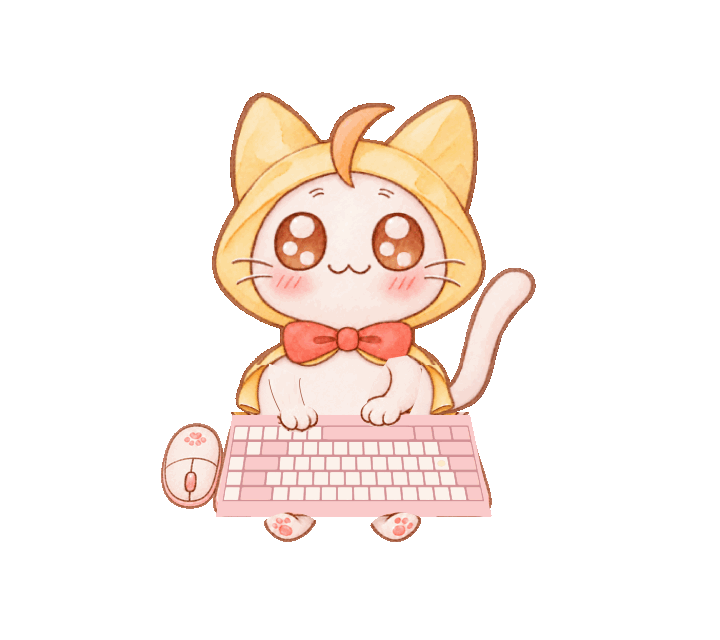
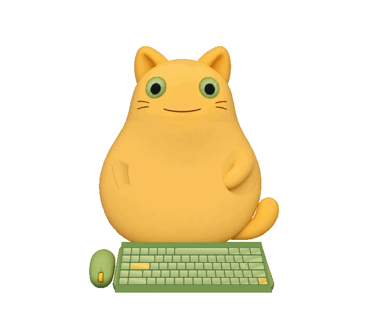
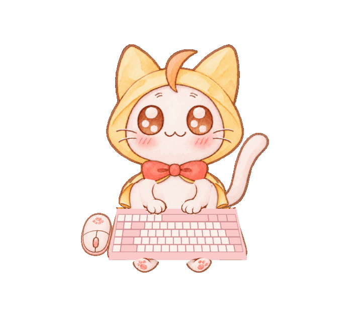
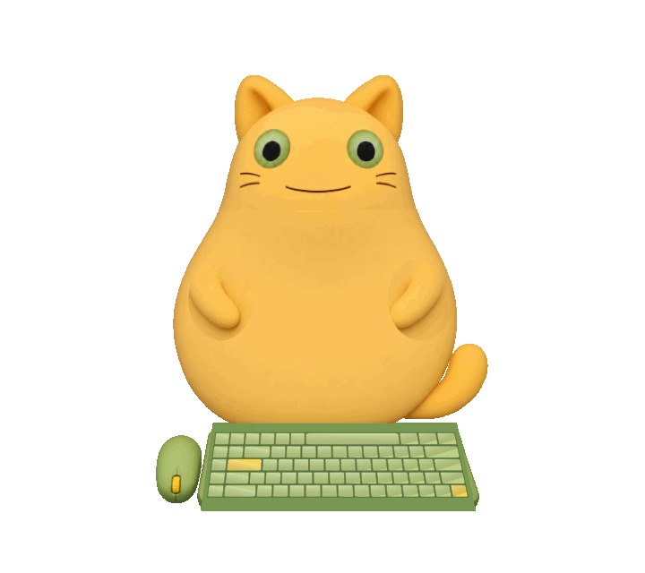

# 大喵与奶咪（Alfie）

This contribution adds two opt-in artwork characters to the macOS application. Select **大喵 · 黄斗篷与粉白键盘** or **奶咪 · 绿眼睛与黄绿键盘** from the Cat Skin menu or Settings → Appearance. Existing installations keep their selected built-in/imported skin until a character is selected.

- **大喵 / Da Miao**: hand-drawn white cat wearing a yellow cape, short splayed hind feet, pink/white keyboard, and three white highlights in each open eye.
- **奶咪 / Nai Mi**: round yellow cat with green eyes, no hind legs, golden arms, and a predominantly green keyboard.
- Creator credit: **Alfie**. The artwork was generated and iteratively edited for this contribution using user-supplied visual references. The reference photographs/screenshots are not included.

## Implementation

`ArtworkRenderer.swift` composites the original face and armless body plate, then applies CatPhysics springs to the texture and separate foreground arms. It uses Core Image warping when available and a triangle-mesh fallback otherwise. The keyboard has 68 blank keycaps in ANSI 65% positions (15/15/14/14/10); its spacebar faces the cat and its mouse sits on the viewer’s left. The original keyboard layout remains unchanged for other skins.

Native typing/mouse targeting, blink, yawn, petting, hunting, dizziness, sleep and pickup/release are replayed through the existing physics. Picking up a cat fades the equipment, relaxes the arms and leaves room for the ear tips. The case occludes Da Miao’s lower torso. These characters disable the extra-foot/tail typing easter eggs and tablet mode; they retain their own eye and keyboard colors and blank legends. Settings for other skins are preserved.

The existing InputEngine is used without modification. Builds continue to use the upstream bundle identifier and signing process. This change does not request additional input permissions or migrate/reset macOS privacy permissions. Live global input was not exercised by the offscreen tests.

## Scope

This is a macOS renderer contribution, not a `.kurocat` skin export. Windows/Linux renderers and the Workshop skin format are unchanged. A Windows/Linux implementation would be a separate port. Bundled assets add about 5 MB before compression.

## Validation

Run on macOS:

```sh
bash scripts/check-artwork.sh
bash scripts/check-skins.sh
bash scripts/check-eye-closure.sh
bash build.sh
```

The artwork check exports PNG action frames, typing/petting GIFs and pickup/release GIFs into `review/`. It validates both characters across 13 native action scenarios each, 68 distinct key targets, mouse placement, ear-tip visibility at both drag extremes, torso occlusion, golden arm material, and suppression of extra limbs. The fixtures use scripted offscreen input; they do not start the global input listener or write persistent user preferences. CI runs all three checks.

## Native replay previews

| 大喵：typing / petting | 奶咪：typing / petting |
| --- | --- |
|  |  |

| 大喵：pickup / release | 奶咪：pickup / release |
| --- | --- |
|  |  |
